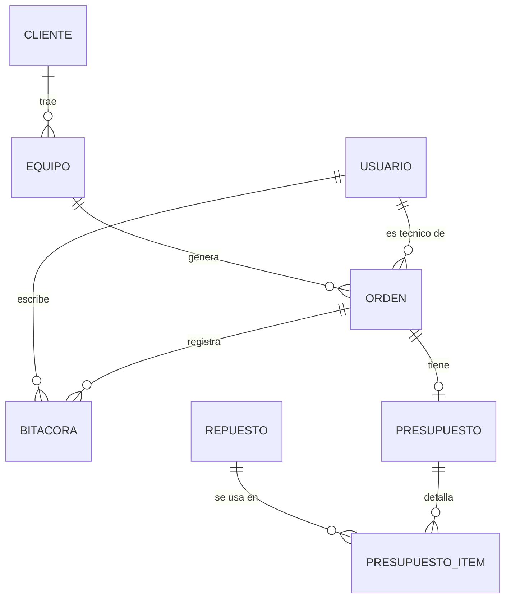

# Modelo de datos y reparto

Fuente: propuesta técnica del Grupo 2. Este documento fija los **nombres de campos y relaciones** para que el front y el back de cada módulo encajen. También es la base del diagrama entidad/relación que se entrega.

> Convenciones: ids numéricos, nombres de campos en español y `camelCase`, fechas en formato ISO 8601 (`"2026-11-02T10:15:00.000Z"`). Las interfaces ya existentes (`Usuario`) se mantienen tal cual.

## Diagrama entidad/relación

## Entidades

### Usuario (ya implementado)
`id`, `nombre`, `apellido`, `email`, `rol` (`administrador` | `recepcionista` | `tecnico`), `activo`

### Cliente
| Campo | Tipo | Notas |
|---|---|---|
| id | number | |
| nombre, apellido | string | |
| dni | string | único; se usa en el buscador rápido |
| telefono, email | string | para confirmaciones |
| activo | boolean | baja lógica |
| createdAt | string (ISO) | |

Búsqueda (`q`): nombre, apellido, dni, telefono, email.

### Equipo
| Campo | Tipo | Notas |
|---|---|---|
| id | number | |
| clienteId | number | → Cliente |
| tipo | string | celular, bicicleta, moto, electrodoméstico, etc. |
| marca, modelo | string | |
| identificador | string | serie, IMEI, patente… |
| condicion | string | estado físico al ingreso |
| observaciones | string | |
| createdAt | string (ISO) | |

Búsqueda (`q`): tipo, marca, modelo, identificador. En el detalle se muestran los datos del cliente.

### Orden de trabajo
| Campo | Tipo | Notas |
|---|---|---|
| id | number | |
| codigo | string | código único de seguimiento público (propuesta: `OT-2026-0001`) |
| equipoId | number | → Equipo |
| tecnicoId | number \| null | → Usuario con rol `tecnico` |
| estado | `EstadoOrden` | ver abajo |
| diagnostico | string | |
| fallas | string | |
| trabajoRealizado | string | |
| fechaIngreso | string (ISO) | |
| fechaEntrega | string (ISO) \| null | |

Búsqueda (`q`): codigo, estado, diagnostico. Filtro adicional por `estado` y `tecnicoId`.

**Estados** (`EstadoOrden`): `recibido` → `en_diagnostico` → `esperando_aprobacion` → `en_taller` → `finalizado` → `entregado`. Se suma `cancelada`, porque el administrador consulta las reparaciones canceladas.

### Bitácora de la orden
`id`, `ordenId` (→ Orden), `usuarioId` (→ Usuario), `fecha`, `descripcion`. Se guarda como lista `bitacora` dentro de la orden (así viene en el mock y en la API); no necesita un CRUD propio en el prototipo.

### Repuesto (catálogo)
| Campo | Tipo | Notas |
|---|---|---|
| id | number | |
| codigo | string | |
| nombre | string | |
| costo | number | costo unitario |
| stock | number | |
| activo | boolean | |

Búsqueda (`q`): codigo, nombre.

### Presupuesto
| Campo | Tipo | Notas |
|---|---|---|
| id | number | |
| ordenId | number | → Orden (uno por orden) |
| manoDeObra | number | |
| total | number | mano de obra + ítems |
| estado | `pendiente` \| `aprobado` \| `rechazado` | el cliente lo resuelve desde el seguimiento público |
| createdAt | string (ISO) | |

**Ítem de presupuesto:** `id`, `presupuestoId`, `repuestoId`, `cantidad`, `costoUnitario`. Se guarda como lista `items` dentro del presupuesto.

## Reparto de entidades (propuesta, a confirmar entre todos)

La consigna pide al menos una entidad completa por integrante (listado paginado con búsqueda, detalle en formulario, reporte exportable y CRUD en la API).

| Integrante | Entidad principal | Además |
|---|---|---|
| Lucía Aguero | Clientes | Seguimiento público (consulta por código, línea de tiempo, aprobar/rechazar presupuesto) |
| Joaquín Pignotti | Equipos | Dashboard y estadísticas del Home |
| Franco Sinigaglia | Órdenes de trabajo | Tablero por estado y bitácora |
| Mateo Barrera | Presupuestos y repuestos | Usuarios (admin), base compartida, colección Postman y diagrama E/R |

Dependencias a tener en cuenta: Equipos necesita Clientes, y Órdenes necesita Equipos y Usuarios. En el prototipo se resuelve con ids fijos en los mocks (por ejemplo, el equipo 1 pertenece al cliente 1), así nadie queda bloqueado esperando a otro.

## Pendiente de acordar

- [ ] Confirmar el reparto de la tabla anterior.
- [ ] Confirmar los estados de la orden y el formato del código de seguimiento.
- [ ] Definir el catálogo base de repuestos y tipos de equipos frecuentes (lo pide la propuesta para iniciar).
